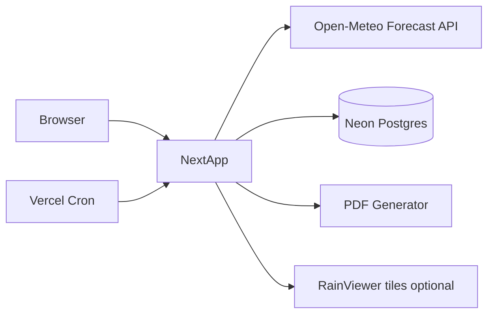

# SB Company Weather Monitoring & Forecast System

## Architecture (Vercel-smart)

Single **Next.js 15 (App Router) + TypeScript + Tailwind** app. Frontend and backend live in one deployable unit — API routes and server actions keep secrets off the client; no separate Express server.



| Layer | Choice | Why |
|---|---|---|
| Hosting | Vercel | Requested; serverless + cron |
| UI | Next.js App Router + Tailwind | SSR-friendly industrial dashboard |
| Charts | Chart.js via `react-chartjs-2` | Gauges/trends as specified |
| Weather API | Open-Meteo Forecast (+ Previous Runs for history bootstrap) | No key for eval; commercial key via env |
| DB | Neon Postgres + Prisma | Persistent timestamped history on Vercel |
| PDF | `@react-pdf/renderer` | Multi-page branded corporate PDF |
| Cron | `vercel.json` crons (Asia/Baghdad 05:30 / 05:45 / 06:00) | Daily fetch → prepare → PDF |
| Auth | Simple session login (env credentials) | Protects Settings + report approval; not public weather site |
| Radar | RainViewer widget with coverage check | If no useful tiles for Artawi, show **Radar unavailable** — never fake imagery |

**Commercial note (documented in README):** Open-Meteo free tier is non-commercial. Production for SB/TotalEnergies requires `OPEN_METEO_API_KEY` + `customer-api.open-meteo.com`. App supports both free (dev) and customer (prod) endpoints via env.

## Branding & design

- Logo source: [assets/image-657f5eff-e617-42d8-bc3b-c89cb24030b2.png](C:\Users\pc\.cursor\projects\d-startups-sb-weather-forcast\assets\image-657f5eff-e617-42d8-bc3b-c89cb24030b2.png) → copy to `public/brand/sb-logo.png` (full logo) + cropped `sb-mark.png` favicon from SB monogram.
- Company: **Sokhoor Al-Behar Co. (SB)** / شركة صخور البحار — General Contracting Ltd.
- Palette: deep corporate blue (`#1B2A4A` / `#2E3192`), white, industrial green (`#1F7A4D`), alert red/orange/yellow; accent red from logo sparingly.
- Industrial control-room layout: dense but readable panels, no card clutter in hero, no flashy animations.
- **Data attribution banner on every weather view:** “Model-derived meteorological estimate (Open-Meteo) — not on-site instrument measurements.”

## Location & refresh

- Default coords (editable in Settings): `lat 30.56328`, `lon 47.09944`, `Asia/Baghdad`.
- Server-side refresh every **15 minutes** (in-memory/cache + DB write). Client polls `/api/weather/current` on the same cadence.
- Status strip: last success, next update, source, connection OK/FAIL.

## App structure

```
app/
  (auth)/login/page.tsx
  (dashboard)/layout.tsx          # sidebar nav + header logo
  (dashboard)/page.tsx            # Main Dashboard
  (dashboard)/current/page.tsx
  (dashboard)/hourly/page.tsx
  (dashboard)/daily/page.tsx
  (dashboard)/wind/page.tsx
  (dashboard)/alerts/page.tsx
  (dashboard)/history/page.tsx
  (dashboard)/radar/page.tsx
  (dashboard)/hse/page.tsx
  (dashboard)/reports/page.tsx
  (dashboard)/settings/page.tsx
  api/weather/refresh/route.ts
  api/weather/current/route.ts
  api/weather/history/route.ts
  api/alerts/route.ts
  api/reports/generate/route.ts
  api/reports/[id]/download/route.ts
  api/reports/[id]/approve/route.ts
  api/cron/morning/route.ts
  api/radar/status/route.ts
lib/
  open-meteo.ts                   # fetch + normalize
  alerts.ts                       # threshold engine
  hse-advisory.ts                 # risk → precautions
  weather-labels.ts               # WMO codes → text
components/
  gauges/WindSpeedGauge.tsx
  gauges/WindCompass.tsx
  charts/TrendCharts.tsx
  alerts/AlertBanner.tsx
  reports/DailyWeatherPdf.tsx
prisma/schema.prisma
```

**Nav (exact):** Main Dashboard · Current Weather · Hourly Forecast · 7-Day Forecast · Wind Monitoring · Weather Alerts · Weather History · Weather Radar · HSE Weather Advisory · Daily PDF Reports · System Settings.

## Feature implementation

### Live dashboard panels
- **Wind gauge:** km/h + colour risk bands from configurable thresholds; max gust; condition text.
- **Compass:** N–NW ring, degrees + abbreviation.
- **Evolution charts:** wind, temp, humidity, gust from stored history (timestamps).
- **Current conditions grid:** temp, feels-like, max/min (day), RH, pressure, wind, gust, direction, visibility, cloud, precip — all labeled as API/model-derived.
- **Hourly (≥24h)** and **7-day** tables from Open-Meteo `hourly` / `daily`.

### Alerts (GREEN / YELLOW / ORANGE / RED)
Configurable in Settings + DB (`AlertThreshold`). **Defaults are placeholder site defaults**, clearly labeled *“Replace with approved site / client HSE limits — not TotalEnergies official values.”* Categories: high wind, extreme heat, dust (visibility + weather code), low visibility, heavy rain, thunderstorms, lightning when weather codes support it.

### HSE Weather Advisory
Rule engine maps active alert levels → precaution lists (heat, wind/lifting, dust, rain, thunderstorms). Copy is generic HSE practice language, not client-procedure invention. UI states advisories are **guidance pending site procedure confirmation**.

### History
On each successful refresh, upsert timestamped readings into Neon (`WeatherReading`). History pages query 24h / 7d series. Bootstrap first load from Open-Meteo recent hours so charts are not empty.

### Radar
Proxy/status check for RainViewer tiles centered on site coords. If coverage empty or service fails → panel: **“Weather radar data unavailable for Artawi/Basra area.”** No fabricated images. Document RainViewer free terms vs commercial need.

### Daily PDF report
`@react-pdf/renderer` template with SB logo, titles:

- SB COMPANY — DAILY WEATHER FORECAST & MONITORING REPORT  
- Client: TOTALENERGIES · Project: ARTAWI GAS FIELD · Location: BASRA, IRAQ  

Includes all 13 required sections, Prepared By HSE Department / Reviewed By HSE Manager / Client TotalEnergies. Download button; status workflow: `draft → pending_review → approved` (no auto-email).

### Morning schedule (Vercel Cron, Asia/Baghdad)
- `05:30` refresh weather  
- `05:45` prepare report draft  
- `06:00` generate PDF, status `pending_review`  

Cron routes secured with `CRON_SECRET`. Configurable times stored in Settings (cron expressions documented for Vercel).

### Auth & security
- Login page with SB logo; credentials from `AUTH_USERNAME` / `AUTH_PASSWORD` (hashed compare).
- Settings + report approve require authenticated session (HTTP-only cookie).
- No weather API keys in client bundles; only server env: `OPEN_METEO_API_KEY`, `DATABASE_URL`, `CRON_SECRET`, auth secrets.

## Database (Prisma / Neon)

- `SiteConfig` — lat/lon/timezone/refresh minutes/report schedule  
- `WeatherReading` — timestamped current snapshot fields  
- `AlertThreshold` — metric, yellow/orange/red values, enabled  
- `DailyReport` — date, status, pdf bytes or storage path, metadata  
- `AuditLog` — approvals / setting changes  

## Deliverables & docs

1. Full runnable Next.js app in repo root  
2. `.env.example` with all vars  
3. `README.md`: local run, Neon setup, Open-Meteo commercial key, Vercel deploy, cron, logo, threshold configuration  
4. Explicit list of paid/external needs: Open-Meteo commercial licence; Neon free tier OK to start; RainViewer commercial if required  

## Out of scope (explicit)
- Auto-email to TotalEnergies  
- Claiming API data as on-site instruments  
- Fabricated radar or live values  
- Inventing TotalEnergies HSE numeric limits  

## Implementation order
1. Scaffold Next.js + Tailwind + Prisma + brand assets  
2. Open-Meteo client + refresh/cache + DB persistence  
3. Dashboard shell + all nav pages with live data  
4. Gauges, compass, charts, alerts, HSE module  
5. PDF + report workflow + cron  
6. Radar panel with unavailable fallback  
7. Settings, auth, README, deploy verification against real API  
